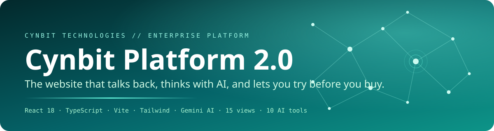
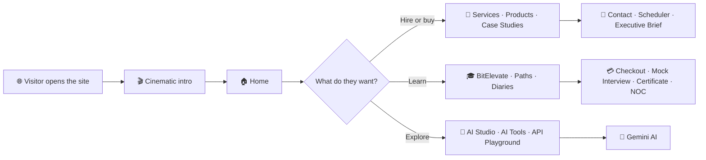
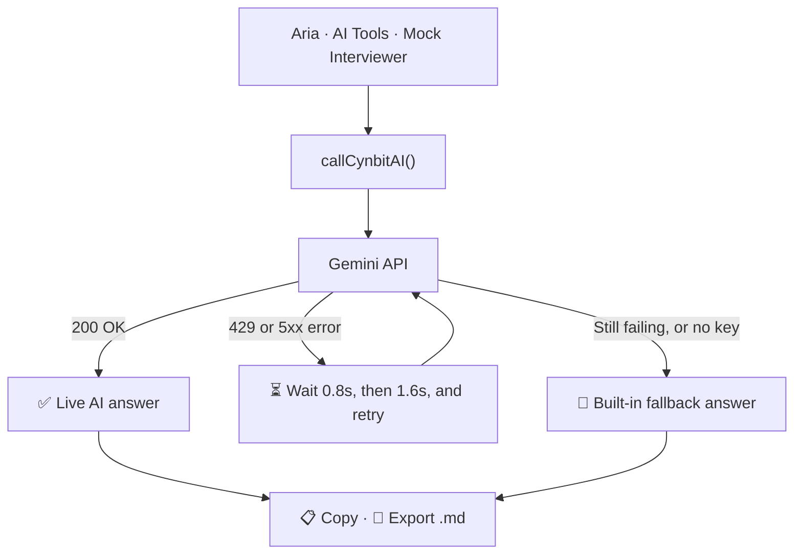
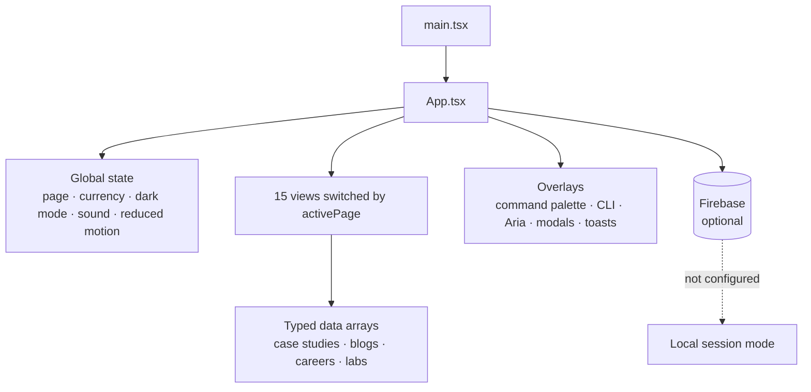

<div align="center">



# 🚀 Cynbit Platform 2.0
### *A company website that talks back, thinks with AI, and lets you try the product before you buy it.*


**[🌐 Live demo](https://cynbit-platform-upgrade.vercel.app/)** &nbsp;·&nbsp; **[📄 Technical report](TECHNICAL_REPORT.md)** &nbsp;·&nbsp; **[🏢 Original site](https://cynbit.in/)**

`15 views` · `36 interactive features` · `10 AI tools` · `11 case studies` · `3 currencies` · `2 languages for the AI copilot`

</div>

---

## 🧒 What is this? (explained for a 10-year-old)

Imagine you walk into a **super-cool tech company's headquarters** and, instead of only reading posters on the wall, you can **press buttons, ask a robot questions and test the machines yourself**.

| In the headquarters | In this website |
|---|---|
| 🎬 A movie-style lobby plays when you enter | A **cinematic intro** boots up before the home page |
| 🧭 A magic map takes you anywhere instantly | Press **Ctrl/Cmd + K** to open the **command palette** |
| 🤖 A friendly robot guide answers your questions | **Aria**, the AI copilot, answers by text or voice, in English or Hinglish |
| 🧪 A lab with 10 smart machines | The **AI Tools Hub**: write specs, review code, fix bugs, polish resumes |
| 💱 A desk that converts prices into your money | The **currency switcher**: ₹ INR, $ USD, € EUR |
| 🎓 A school where students build real projects | **BitElevate**: a 60-day program with a syllabus, mock interviews and certificates |
| 🌙 A dimmer switch for the lights | **Dark mode** and a **reduced-motion** switch for calmer screens |
| 🛟 A backup generator if the power fails | If the AI is busy, the site uses **fallback answers**, so it never shows a broken screen |

> ⚠️ **It is a demo.** Numbers like latency, charts and sample talent profiles are written into the code to show how the interface works. They are not live readings from real servers.

---

## ⚡ Try it in 60 seconds (the quest board)

No login needed. Just open the site and complete the quests.

| # | Quest | Do this | You will see |
|---|---|---|---|
| 1 | 🎬 **Watch the lobby** | Load the home page | A cinematic boot sequence, then a hero with a moving particle network |
| 2 | 🧭 **Use the magic map** | Press `Ctrl/Cmd + K` | A search palette that jumps to any page |
| 3 | 💻 **Open the hacker terminal** | Press `~` and type `help` | The **Cynbit Architect CLI**. Try `cynbit --stack`, `ping jaipur`, `bitelevate --tracks`, `team --founders` |
| 4 | 🤖 **Chat with Aria** | Open the floating copilot, switch **EN → Hinglish**, or tap the mic | Replies in both styles, with voice input |
| 5 | 💱 **Change the money** | Pick **USD** or **EUR** in the header | Every price on **Services** and **BitElevate** updates instantly |
| 6 | 🎟️ **Use a coupon** | BitElevate → checkout → enter `CYNBIT200` | The price drops from **₹1,499 to ₹1,299** |
| 7 | 🏅 **Verify a certificate** | BitElevate → certificate check → enter `CYN-BE-2026-1042` | A verified certificate card with a generated QR code |
| 8 | 🧪 **Run an AI tool** | **AI Tools Hub** → pick a tool → use the sample input | An AI answer you can **copy** or **download as `.md`** |
| 9 | 🔌 **Call the API** | **AI Studio** → REST API Playground | A simulated request, a trace ID and a one-click **cURL** copy |
| 10 | 🌙 **Dim the lights** | Click the moon icon | The whole site switches to Midnight-Teal |

---

## ✨ 36 features (and where to find them)

<details open>
<summary><b>🧭 Navigation and polish (1–10)</b></summary>

| # | Feature | Where to see it | Idea behind it |
|---|---|---|---|
| 1 | Cinematic boot intro | On first load | Timed animation phases |
| 2 | Neural constellation hero | **Home** | HTML5 canvas, particles repel the cursor |
| 3 | Animated KPI counters | **Home** | `IntersectionObserver` + `requestAnimationFrame` |
| 4 | Aurora spotlight cards | Dark sections | CSS variables `--mx` / `--my` follow the mouse |
| 5 | Command palette | `Ctrl/Cmd + K` | Global key handler + search list |
| 6 | Keyboard shortcuts | `Esc` closes things, `~` opens the CLI | Key listener that ignores text inputs |
| 7 | One-at-a-time modal layer | Blog and case-study readers | Single modal state, no stacked overlays |
| 8 | Dark mode | Moon icon | Midnight-Teal overrides |
| 9 | Reduced-motion mode | Header toggle | One class switches off animations |
| 10 | Tactile micro-sounds | Sound toggle | Web Audio API, **no audio files** |

</details>

<details open>
<summary><b>💼 For buyers and founders (11–21)</b></summary>

| # | Feature | Where to see it | Idea behind it |
|---|---|---|---|
| 11 | Multi-currency engine | Header | Central rate table, `Intl.NumberFormat` |
| 12 | Before vs. After slider | **Home** | Draggable comparison of old vs. new architecture |
| 13 | AI automation ROI simulator | **Home** | Sliders with live INR/USD/EUR results |
| 14 | 11-project case study library | **Case Studies** | Category filters + a simulator per project |
| 15 | Engagement models + pod-size slider | **Services** | 2–8 engineers, price recalculates |
| 16 | TenantEase collections chart | **Products** | Hand-built bar chart with tooltips |
| 17 | Revio sentiment switcher | **Products** | Per-city sentiment data |
| 18 | Cynbit Studio quality radar | **Products** | Four-axis SVG radar |
| 19 | Discovery call scheduler | **Contact** | IST slots: 11:00 AM, 03:00 PM, 06:30 PM |
| 20 | Executive Brief exporter | **AI Studio** | Generates `Cynbit-Executive-Brief.md` |
| 21 | Website and AI readiness grader | **AI Studio** | Enter a URL, get a score out of 100 |

</details>

<details open>
<summary><b>🛠️ For developers and AI explorers (22–28)</b></summary>

| # | Feature | Where to see it | Idea behind it |
|---|---|---|---|
| 22 | Cloud latency monitor | **AI Studio** | Jaipur, Mumbai, Singapore, Frankfurt |
| 23 | REST API playground | **AI Studio** | 3 endpoints, trace IDs, cURL export |
| 24 | Developer CLI | Press `~` | Command parser with history buttons |
| 25 | AI scope studio | **AI Studio** | Pick a track and modules, get an estimate |
| 26 | Live architecture diagram | **AI Studio** | SVG that redraws as modules toggle |
| 27 | Aria copilot | Floating button | Gemini + Web Speech API + English/Hinglish |
| 28 | AI Tools Hub (10 tools) | **AI Tools Hub** | Shared Gemini pipeline, copy + `.md` export |

</details>

<details open>
<summary><b>🎓 BitElevate student suite (29–34)</b></summary>

| # | Feature | Where to see it | Idea behind it |
|---|---|---|---|
| 29 | Sprint checkout + `CYNBIT200` coupon | **BitElevate** | Live price validation |
| 30 | 60-day syllabus modal | **BitElevate** | Week-by-week curriculum |
| 31 | Commit heatmap | **BitElevate** | GitHub-style grid built with plain components |
| 32 | AI mock technical interviewer | **BitElevate** | Full-Stack, Python or AI Systems track, structured feedback |
| 33 | Certificate check + QR | **BitElevate** | Registry lookup, deterministic SVG QR |
| 34 | NOC letter generator + ambassador calculator | **BitElevate** | Downloadable `.txt`; 10 referrals unlock a free seat |

</details>

<details open>
<summary><b>🧱 Under the hood (35–36)</b></summary>

| # | Feature | Where to see it | Idea behind it |
|---|---|---|---|
| 35 | Resilient AI pipeline | Every AI feature | Retry with backoff, then fallback answers |
| 36 | Optional Firebase sync | Status label in the app | Anonymous auth + Firestore, falls back to local session |

</details>

---

## 🧠 How it works

### 1. The visitor's journey



### 2. The AI safety net



### 3. The app structure



---

## 🆚 Original vs. Platform 2.0

| | Original [cynbit.in](https://cynbit.in/) | Platform 2.0 |
|---|---|---|
| Feel | A polished brochure | An interactive product tour |
| Case studies | 9 logos, 4 testimonials on the homepage | 11 detailed studies with filters and ROI simulators |
| AI | Described as a service | **Hands-on**: copilot, 10 tools, scope studio, mock interviewer |
| Pricing | Not on the homepage | 3 engagement models, pod slider, 3 currencies |
| Booking | Contact page | In-page scheduler + downloadable brief |
| Developers | None seen | REST playground, CLI, latency monitor |
| BitElevate | Program description | Checkout, syllabus, heatmap, interview, certificate, NOC |
| Comfort | Light theme | Dark mode, reduced motion, keyboard shortcuts, sound toggle |

Company details (address, phones, email, products, programs) stay consistent with the original brand.

---

## 🗂️ Folder map

```text
cynbit-platform-upgrade/
├─ src/
│  ├─ main.tsx              # React entry point
│  ├─ App.tsx               # the whole platform: data, visuals, 15 views
│  ├─ index.css             # Tailwind layers, fonts, scrollbars
│  └─ vite-env.d.ts         # types for VITE_GEMINI_API_KEY
├─ docs/
│  └─ banner.svg            # the banner at the top of this README
├─ index.html               # page shell + Google Fonts
├─ package.json             # dependencies and scripts
├─ vite.config.js           # Vite + React plugin
├─ tailwind.config.js       # brand colors and fonts
├─ postcss.config.js
├─ tsconfig.json
├─ netlify.toml             # build + SPA rewrite for Netlify
├─ vercel.json              # SPA rewrite for Vercel
├─ .env.example             # template for your secret key
├─ .gitignore               # keeps .env off GitHub
├─ README.md                # you are here
└─ TECHNICAL_REPORT.md      # audit, decisions and impact
```

---

## 🧪 Run it on your computer

```bash
git clone <your-repo-url>
cd cynbit-platform-upgrade
npm install                 # downloads the tools (about 1-2 minutes)
cp .env.example .env        # then paste your key inside .env
npm run dev                 # opens http://localhost:5173
npm run build               # builds the production site into dist/
```

Needs **Node.js 18 or newer** ([download](https://nodejs.org)).

### 🔑 Environment variable

| Name | What it does |
|---|---|
| `VITE_GEMINI_API_KEY` | Your Google Gemini key from [AI Studio](https://aistudio.google.com/). **Optional**: without it the site still works using fallback answers. |

> 🙈 **Never commit `.env`.** It is already listed in `.gitignore`. Put the key only in your computer's `.env` and in your hosting dashboard.

## ☁️ Put it on the internet (free)

**Vercel** (used for the live demo)
1. Import this repo at [vercel.com](https://vercel.com) → preset **Vite** (leave the override switches off).
2. Add the environment variable `VITE_GEMINI_API_KEY`.
3. Click **Deploy**. After changing the key later, choose **Redeploy**.

**Netlify**
1. Import the repo. Settings are read from `netlify.toml` (`npm run build`, publish `dist`).
2. Add `VITE_GEMINI_API_KEY` under *Environment variables*, then deploy.

## 🔒 A note on security

This is a **browser-only** app, so the Gemini key is visible to anyone who opens developer tools. For this demo, restrict the key to your site's domain in Google Cloud and rotate it if it ever leaks. A production version would send AI requests through a **serverless function** so the key stays on the server.

---

## 🎯 Assessment checklist

| Deliverable | Where it is |
|---|---|
| 1. Source code repository | This repo (React + TypeScript + Vite + Tailwind) |
| 2. Live working prototype | https://cynbit-platform-upgrade.vercel.app/ |
| 3. Technical report | [`TECHNICAL_REPORT.md`](TECHNICAL_REPORT.md) |

## 🧰 Tech

React 18 · TypeScript · Vite 6 · Tailwind CSS 3.4 · lucide-react · Google Gemini API · Firebase Auth + Firestore (optional) · HTML5 Canvas · inline SVG · Web Audio API · Web Speech API

## 👤 Author

**Tamiri Sai Vaibhav**
B.Tech, Computer Science & Engineering · Raghu Engineering College, Visakhapatnam
📧 `sai1304tamiri@gmail.com` · 🐙 [@saivaibhavtamiri1306](https://github.com/saivaibhavtamiri1306)
🔖 Application reference: `cmwubpppx001107l9g90prbqu`

## 📜 Note

An independent candidate assessment project. Cynbit's name, logo and company information belong to **Cynbit Technologies**. All sample people, metrics and telemetry in the demo are fictional or illustrative.

<div align="center"><sub>Built with ❤️, React and a lot of mint-teal glow. 🌿</sub></div>
